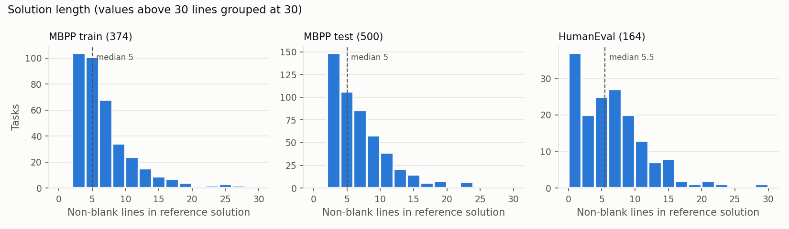
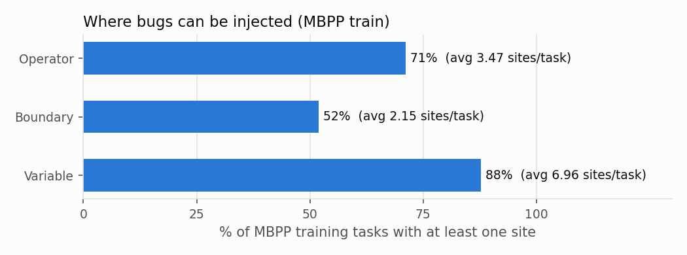
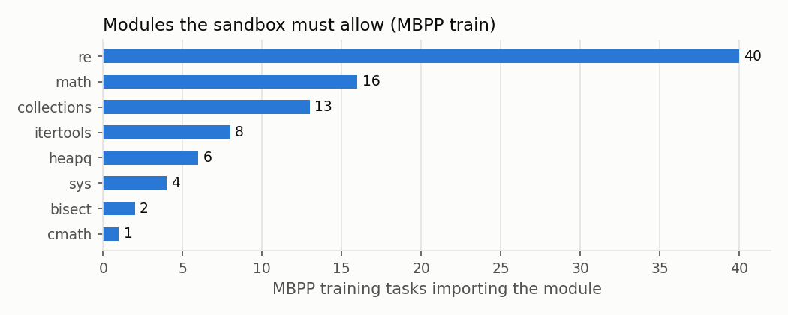
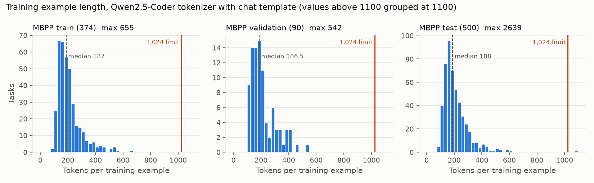

# Data Exploration

This document covers the datasets used for the project: where they come from, what they contain, and
what we learned that affects the bug-mutation pipeline, sandbox and training setup.

All numbers come from [`exploration/data_exploration.py`](exploration/data_exploration.py), which writes
them to [`exploration/stats.json`](exploration/stats.json). The script only **reads and parses** the code
with Python's `ast` module. It never executes any dataset code.

```bash
python exploration/data_exploration.py
```

## 1. Data sources

| Dataset | Source | Size | Role in this project |
|---|---|---|---|
| **MBPP** (Mostly Basic Python Problems) | [google-research/mbpp](https://github.com/google-research/google-research/tree/master/mbpp), `mbpp.jsonl` | 974 tasks | Training and validation (bug-mutation source), held-out MBPP test |
| **MBPP sanitized** | Same repository, `sanitized-mbpp.json` | 427 tasks | Cleaner subset with hand-verified problem statements; kept as an alternative |
| **HumanEval** | [openai/human-eval](https://github.com/openai/human-eval), `HumanEval.jsonl.gz` | 164 tasks | External test benchmark only, never used for training |

Both datasets are also mirrored on Hugging Face (`google-research-datasets/mbpp`, `openai/openai_humaneval`).
[`explore_mbpp.py`](explore_mbpp.py) is a minimal loader for the MBPP train and validation splits.

## 2. Record structure

### MBPP

| Field | Description |
|---|---|
| `task_id` | Integer ID; also determines the split |
| `text` | Natural-language problem statement |
| `code` | Reference solution |
| `test_list` | Three `assert` statements |
| `test_setup_code` | Extra code to run before the tests (almost always empty) |
| `challenge_test_list` | Harder extra tests (only 11 tasks, all in the test split) |

**Example: task 602 (train)**

> Write a python function to find the first repeated character in a given string.

```python
def first_repeated_char(str1):
  for index,c in enumerate(str1):
    if str1[:index+1].count(c) > 1:
      return c
  return "None"
```
```python
assert first_repeated_char("abcabc") == "a"
assert first_repeated_char("abc") == "None"
assert first_repeated_char("123123") == "1"
```

**Example: task 601 (train)**: one of the few tasks that defines a class.

> Write a function to find the longest chain which can be formed from the given set of pairs.

```python
class Pair(object):
	def __init__(self, a, b):
		self.a = a
		self.b = b
def max_chain_length(arr, n):
	max = 0
	mcl = [1 for i in range(n)]
	for i in range(1, n):
		for j in range(0, i):
			if (arr[i].a > arr[j].b and mcl[i] < mcl[j] + 1):
				mcl[i] = mcl[j] + 1
	for i in range(n):
		if (max < mcl[i]):
			max = mcl[i]
	return max
```
```python
assert max_chain_length([Pair(5, 24), Pair(15, 25), Pair(27, 40), Pair(50, 60)], 4) == 3
```

This sample shows two of the quirks covered in Section 5: tab indentation and a variable named `max`
that shadows the built-in.

### HumanEval

| Field | Description |
|---|---|
| `task_id` | e.g. `HumanEval/0` |
| `prompt` | Function signature and docstring (the model completes the body) |
| `canonical_solution` | Reference function body |
| `test` | A `check(candidate)` function with the asserts |
| `entry_point` | Name of the function under test |

**Example: HumanEval/0**

```python
from typing import List

def has_close_elements(numbers: List[float], threshold: float) -> bool:
    """ Check if in given list of numbers, are any two numbers closer to each other than
    given threshold.
    >>> has_close_elements([1.0, 2.0, 3.0], 0.5)
    False
    >>> has_close_elements([1.0, 2.8, 3.0, 4.0, 5.0, 2.0], 0.3)
    True
    """
    for idx, elem in enumerate(numbers):
        for idx2, elem2 in enumerate(numbers):
            if idx != idx2:
                distance = abs(elem - elem2)
                if distance < threshold:
                    return True
    return False
```
```python
def check(candidate):
    assert candidate([1.0, 2.0, 3.9, 4.0, 5.0, 2.2], 0.3) == True
    assert candidate([1.0, 2.0, 3.9, 4.0, 5.0, 2.2], 0.05) == False
    # ... 5 more asserts
```

## 3. Splits

MBPP has an official split by `task_id` (Austin et al., 2021):

| Split | Task IDs | Full | Sanitized | Use in this project |
|---|---|---:|---:|---|
| Prompt | 1–10 | 10 | 7 | Few-shot examples for the prompt-only baseline; never trained or tested on |
| Test | 11–510 | 500 | 257 | Held-out MBPP evaluation |
| Validation | 511–600 | 90 | 43 | Checkpoint selection and hyperparameter tuning |
| Train | 601–974 | 374 | 120 | Source of bug-mutation training data |
| **Total** | | **974** | **427** | |

HumanEval (164 tasks) is used only as an external test set.

**Note on split balance:** the test set (500) is larger than the training set (374) because MBPP was
designed as a few-shot benchmark. We plan to keep the official split: each training task produces
several mutated (buggy) versions, so 374 tasks should yield a few thousand training pairs, and an
untouched test set keeps results comparable with published work. Alternatives we are considering:

- **Rebalance:** move about 250 test tasks into training if mutation yield is low.
- **Subsample the test set:** use around 200 tasks if multi-round evaluation is too slow on the cluster.

## 4. Size and complexity

| | MBPP train | MBPP val | MBPP test | HumanEval |
|---|---:|---:|---:|---:|
| Tasks | 374 | 90 | 500 | 164 |
| Solution lines, median / mean | 5 / 6.5 | 6 / 6.9 | 5 / 6.8 | 5.5 / 6.3 |
| Solution lines, 90th pct / max | 12 / 29 | 13 / 22 | 13 / 50 | 13 / 29 |
| Solution characters, median / 90th pct | 139 / 347 | 144 / 405 | 145 / 347 | n/a |
| Problem statement chars, median | 78 | 73 | 77 | n/a (docstring prompt, median 10.5 lines) |
| Tests per task | 3 (all tasks) | 3 | 3 | median 7, mean 8.1, max 26 |
| Tasks with imports | 90 (24%) | 13 | 87 | typing 21, math 6 |
| Tasks defining a class | 2 | 0 | 2 | n/a |
| Tasks with more than one function | 17 | 6 | 24 | n/a |
| Parse failures (Python 3.14) | 0 | 0 | 0 | 0 |



**Takeaways**

- **Programs are short.** The median solution is about 5 lines and 90% are 13 lines or fewer. A
  repair prompt (problem, buggy code and error message) should fit easily within a 1,024-token
  context, which keeps training cheap on a 0.5B model. We still need to check this with the actual Qwen
  tokenizer.
- **MBPP and HumanEval have similar solution lengths,** so HumanEval is a fair external test in terms
  of size. HumanEval prompts are richer, with typed signatures and docstrings, and HumanEval has more
  than twice as many tests per task.
- **MBPP has only three tests per task.** That is a weak signal: a buggy program could pass all three
  by chance. The mutation pipeline must check that each mutant actually fails at least one test.

## 5. Data quality issues

| Issue | Train | Val | Test | Why it matters |
|---|---:|---:|---:|---|
| Windows line endings (`\r\n`) | 373 / 374 | 90 / 90 | 499 / 500 | Normalize to `\n` before mutating and diffing |
| Tab indentation | 41 (11%) | 13 | 73 (15%) | Mixing with spaces breaks parsing; expand tabs to 4 spaces |
| `SyntaxWarning` (e.g. `"\d"` in a non-raw regex string) | 10 | 1 | 7 | Becomes an error in future Python versions; warnings could be mistaken for model-induced bugs |
| Variable shadows a built-in | 25 (7%) | 9 | 52 (10%) | e.g. `max = 0`, `sum = 0`, `str` as a parameter; variable-swap mutations should avoid these names |

The most commonly shadowed built-ins across all 974 tasks are `sum` (31), `str` (22), `list` (15),
`max` (8) and `dict` (7).

We also found tasks with dead code. Task 631 has `return` statements followed by unreachable lines:

```python
def replace_spaces(text):
  text =text.replace (" ", "_")
  return (text)
  text =text.replace ("_", " ")   # never runs
  return (text)
```

**Planned preprocessing:** convert line endings to `\n`, expand tabs, and re-serialize every solution
with `ast.unparse` so the original and the mutant share identical formatting. That way the only
difference between buggy and fixed code is the injected bug.

## 6. Where bugs can be injected

The project creates training data by injecting three types of bug into correct solutions. The script
counts the **sites** in each solution where each type could be applied:

| Bug type | Sites counted | Example mutation |
|---|---|---|
| Operator | Arithmetic, comparison and boolean operators | `a + b` → `a - b`, `<` → `<=`, `and` → `or` |
| Boundary | `range()` calls, slice bounds, indices like `arr[i]`, integer literals in comparisons | `range(n)` → `range(n + 1)`, `arr[i]` → `arr[i - 1]` |
| Variable | Reads of a local variable in a function that has at least 2 locals | `return total` → `return count` |



| | MBPP train | MBPP test | HumanEval |
|---|---:|---:|---:|
| Tasks with an operator site | 266 (71%) | 390 (78%) | 146 (89%) |
| Tasks with a boundary site | 194 (52%) | 266 (53%) | 127 (77%) |
| Tasks with a variable site | 328 (88%) | 454 (91%) | 142 (87%) |
| Average sites per task (operator / boundary / variable) | 3.5 / 2.2 / 7.0 | 3.8 / 2.3 / 7.7 | 4.1 / 2.4 / 7.5 |

On the training split:

- **349 of 374 tasks (93%)** have at least one site of some type.
- **164 (44%)** have sites for all three types.
- **25 tasks have no sites at all.** These are one-liners that only call built-ins, such as task 604,
  `return ' '.join(reversed(s.split()))`, and they can't produce mutants of our three types.

**Takeaways**

- There is plenty of material for **variable** and **operator** bugs.
- **Boundary** bugs are the scarcest: only half of the training tasks have a site. If we want balanced
  bug types in the training set, we should cap the variable and operator mutants per task instead of
  sampling uniformly.
- **These are upper bounds.** Some mutations won't change the program's behaviour (equivalent mutants)
  or won't be caught by just three tests. The real yield can only be measured by running the tests,
  which is the first step of the mutation pipeline (Section 8).

## 7. Imports and sandbox requirements



Only 24% of training solutions import anything, and all imports are from the standard library: `re`,
`math`, `collections`, `itertools`, `heapq`, `sys` and `bisect`. HumanEval mostly imports `typing`.
The execution sandbox can therefore use a standard-library-only allow-list. No third-party packages
are needed.

## 8. Next steps

Next we move from reading the code to running it, as part of building the mutation pipeline:

1. **Validate references.** Run every reference solution against its tests in the sandbox (with a
   timeout) and drop any that fail under our Python version.
2. **Measure mutation yield.** Done, see Section 10: 2,741 train, 693 validation and 1,483 held-out
   test examples (levels 1 and 2).
3. **Count tokens.** Done, see Section 9: keep `max_seq_length = 1024`.
4. **Confirm the split decision.** Done: we keep the official split, since the mutation yield is high
   enough (Section 10).

## 9. Token lengths

We measured training-example length with the actual model tokenizer (`Qwen/Qwen2.5-Coder-0.5B-Instruct`)
to set `max_seq_length`. Script: [`exploration/token_lengths.py`](exploration/token_lengths.py), output in
[`exploration/token_lengths.json`](exploration/token_lengths.json).

```bash
python exploration/token_lengths.py
```

**How each example is built.** One example per task in our training format (Problem / Buggy code /
Test feedback / Corrected code), wrapped with `tok.apply_chat_template`: the problem, buggy code and
feedback are the user message and the corrected code is the assistant reply. Bugs don't exist yet, so
the reference solution is used for both the buggy and the corrected code (a mutation changes only a few
tokens). The feedback is `AssertionError:` plus the task's first test line. Code is normalised as in
Section 5 (`\n` line endings, tabs expanded). The chat template and Qwen's default system prompt add a
fixed 49 tokens to every example.

| Split | Tasks | Median | 90th pct | Longest | Over 512 | Over 1,024 |
|---|---:|---:|---:|---:|---:|---:|
| Train | 374 | 187 | 315 | 655 (task 950) | 7 (1.9%) | **0** |
| Validation | 90 | 186.5 | 349 | 542 (task 522) | 1 (1.1%) | **0** |
| Test | 500 | 188 | 312 | 2,639 (task 493) | 7 (1.4%) | 1 (0.2%) |



**Stress check: all three tests in the feedback.** Real error output may be longer than one assert
line. Putting all three test lines in the feedback raises the train median to 248 and the longest train
example to 764 tokens (782 in validation). Still no train or validation example goes over 1,024.

**Outlier: test task 493** (hexagon grid). Its expected output is a 1,900-character list of float
tuples written inside the assert, so quoting the assert in the feedback makes the example 2,639 tokens.
It is in the test split, so it does not affect training, but the evaluation harness should
**truncate long feedback** (for example to the last 300–500 characters of the error) so prompts stay
bounded.

**Recommendation: keep `max_seq_length = 1024`.**

- Every train and validation example fits, with room to spare: the longest is 655 tokens with one test
  in the feedback and 764 with all three. Lowering the limit to 512 would truncate 7 train examples
  (19 at 384, 75 at 256), and truncation would cut off the corrected code the model is supposed to learn.
- Real tracebacks (`Traceback ...`, `File "<string>", line N`) and later correction rounds that include
  earlier attempts will make prompts longer than this estimate, so the headroom is useful.
- The higher limit costs very little: the trainer pads each batch to its longest example, not to
  `max_seq_length`, and the typical example is under 200 tokens. If GPU memory gets tight on the HPC,
  reduce batch size before reducing the limit, or try 768 (no train example is longer than 768 with one
  test of feedback).
- Re-run this script once the mutation pipeline produces real buggy code and error messages.

## 10. Mutation dataset

[`src/mutate.py`](src/mutate.py) builds the training, validation and held-out test data. Statistics are
written to [`exploration/mutation_stats.json`](exploration/mutation_stats.json) and the examples to
`data/processed/{train,validation,test}.jsonl` (git-ignored). It uses `sandbox.py`, which needs Linux,
macOS or WSL. A full run takes about 8 minutes on 16 cores.

```bash
python src/mutate.py                  # all three splits
python src/mutate.py --splits test    # one split; the other splits' statistics are kept
```

**How it works.**

1. Each reference solution is normalized (Section 5) and re-serialized with `ast.unparse`, then run
   in the sandbox. Only references that still pass are mutated.
2. Every single-mutation site is listed:
   - **Operator:** `+`↔`-`, `*`→`+`, `/`→`*`, `//`→`/`, `%`→`//`, `**`→`*`, `<`↔`<=`, `>`↔`>=`,
     `==`↔`!=`, `in`↔`not in`, `is`↔`is not`, `and`↔`or`
   - **Boundary:** ±1 on the `range()` stop, slice bounds, indices and integer literals in comparisons
   - **Variable:** a read of a local variable is replaced by another local of the same function. The
     replacement must be defined on an earlier line, and names that shadow built-ins are skipped.
3. Duplicate mutants and mutants identical to the reference are dropped. Up to 10 candidates per task
   and bug type are sampled (seed 258) and run against the three tests with a 3 s timeout.
4. **Level 1:** a mutant is usable only if it **fails** at least one test. At most 3 are kept per task
   and bug type.
5. **Level 2:** 2 or 3 of the single mutations that failed on their own are combined into one mutant,
   so every bug in it is one the tests can detect and the model has to fix all of them. Each mutation
   picks a bug type uniformly before picking a site, so the many variable sites don't crowd out the
   other types. Two mutations are not combined if they hit the same node or one sits inside an
   expression the other replaces. Up to 10 combinations are run per task and at most 3 failing ones
   kept.
6. **Test split:** MBPP tasks 11–510 go through the same steps with the same seed, but keep only **1**
   mutant per task and bug type (and 1 level 2 mutant per task) to bound the evaluation cost. Tasks
   1–10 are left out for few-shot prompts. These examples are for evaluation only.

**Final dataset.**

| Split | Tasks (valid) | Tasks with an example | Level 1 | Level 2 | Total |
|---|---:|---:|---:|---:|---:|
| Train | 374 (373) | 338 | 1,876 | 865 | **2,741** |
| Validation | 90 (90) | 84 | 482 | 211 | **693** |
| Test (held out) | 500 (498) | 479 | 1,050 | 433 | **1,483** |

**Level 1 yield.** Train and validation are unchanged from pipeline v1.

| Train | Tasks with a site | Candidates | Run | Fail tests | Pass tests | Kept |
|---|---:|---:|---:|---:|---:|---:|
| Operator | 265 | 1,262 | 1,088 | 910 (83.6%) | 178 | 568 |
| Boundary | 194 | 1,606 | 1,086 | 857 (78.9%) | 229 | 487 |
| Variable | 315 | 7,432 | 2,033 | 1,898 (93.4%) | 135 | 821 |
| **Total** | | 10,300 | 4,207 | 3,665 (87.1%) | 542 | **1,876** |

| Validation | Tasks with a site | Candidates | Run | Fail tests | Pass tests | Kept |
|---|---:|---:|---:|---:|---:|---:|
| Operator | 62 | 303 | 277 | 234 (84.5%) | 43 | 156 |
| Boundary | 49 | 424 | 278 | 229 (82.4%) | 49 | 124 |
| Variable | 78 | 2,152 | 531 | 508 (95.7%) | 23 | 202 |
| **Total** | | 2,879 | 1,086 | 971 (89.4%) | 115 | **482** |

| Test (cap 1) | Tasks with a site | Candidates | Run | Fail tests | Pass tests | Kept |
|---|---:|---:|---:|---:|---:|---:|
| Operator | 383 | 1,815 | 1,638 | 1,409 (86.0%) | 229 | 369 |
| Boundary | 264 | 2,270 | 1,472 | 1,144 (77.7%) | 328 | 250 |
| Variable | 433 | 11,163 | 2,898 | 2,674 (92.3%) | 224 | 431 |
| **Total** | | 15,248 | 6,008 | 5,227 (87.0%) | 781 | **1,050** |

"Pass tests" mutants are equivalent to the reference or not caught by MBPP's three tests. They are
discarded.

**Level 2 yield.**

| Split | Tasks with a combination | Run | Fail tests | Pass tests | Kept | 2 / 3 mutations |
|---|---:|---:|---:|---:|---:|---:|
| Train | 305 | 2,691 | 2,672 (99.3%) | 19 | 865 | 565 / 300 |
| Validation | 73 | 660 | 653 (98.9%) | 7 | 211 | 139 / 72 |
| Test (cap 1) | 433 | 3,813 | 3,772 (98.9%) | 41 | 433 | 298 / 135 |

In the kept train level 2 examples, 69% mix two or three bug types. Operator mutations appear in 58% of
them, variable in 78% and boundary in 40%. The `bug_type` of a level 2 example lists the types it
contains, for example `operator+variable`.

Error types in the kept examples (the feedback the model sees):

| Error type | Train L1 | Train L2 | Validation L1 | Validation L2 | Test L1 | Test L2 |
|---|---:|---:|---:|---:|---:|---:|
| `AssertionError` (wrong output) | 1,325 (70.6%) | 475 (54.9%) | 335 (69.5%) | 113 (53.6%) | 798 (76.0%) | 275 (63.5%) |
| `TypeError` | 264 (14.1%) | 233 (26.9%) | 66 (13.7%) | 52 (24.6%) | 117 (11.1%) | 93 (21.5%) |
| `IndexError` | 179 (9.5%) | 81 (9.4%) | 42 (8.7%) | 19 (9.0%) | 74 (7.0%) | 30 (6.9%) |
| `TimeoutError` | 34 (1.8%) | 12 (1.4%) | 13 (2.7%) | 7 (3.3%) | 22 (2.1%) | 9 (2.1%) |
| Other (`AttributeError`, `RecursionError`, `ZeroDivisionError`, `ValueError`, `KeyError`, ...) | 74 (3.9%) | 64 (7.4%) | 26 (5.4%) | 20 (9.5%) | 39 (3.7%) | 26 (6.0%) |

**Feedback format.** The sandbox traceback is cleaned up so that it points to the buggy code rather
than to the sandbox. It shows the failing assert, at most the 3 innermost frames (repeated recursive
calls are collapsed) and the error, and it is capped at 500 characters. The median is 83 characters
for level 1 and 105 for level 2. Example (task 627, `==` → `!=`):

```
Failed test: assert find_First_Missing([0,1,2,3],0,3) == 4
Traceback (most recent call last):
  line 9, in find_First_Missing
    return find_First_Missing(array, start, mid)
  [called 992 times in a row]
RecursionError: maximum recursion depth exceeded
```

Level 2 example (task 602, two boundary changes on the same line). The reference is
`if str1[:index + 1].count(c) > 1:`:

```python
def first_repeated_char(str1):
    for index, c in enumerate(str1):
        if str1[:index].count(c) > 2:
            return c
    return 'None'
```

```
Failed test: assert first_repeated_char("abcabc") == "a"
AssertionError
```

Each JSONL line holds `task_id`, `split`, `problem`, `tests`, `buggy_code`, `feedback`, `fixed_code`,
`bug_type`, `mutation` (e.g. `line 13: + -> -`, with level 2 changes separated by `; `),
`num_mutations` (1–3), `error_type`, `level` (1 or 2) and `round` (1).

**Takeaways**

- **Yield is high enough to keep the official split.** 338 of 374 train tasks produce at least one
  example, so we don't rebalance (Section 3). Level 2 adds 46% more training examples on top of level 1.
- **Level 2 bugs almost always fail (99%)**, because each mutation in them already fails alone. The
  few that pass are combinations where the bugs cancel out.
- **Level 2 feedback is more often a crash.** A variable swap is in 78% of level 2 bugs, so `TypeError`
  doubles (27% vs 14% in train). The model sees more tracebacks and fewer plain wrong outputs.
- **Caps stay at 3 per task and bug type.** Level 1 train is 30% operator, 26% boundary and 44%
  variable. That is uneven but not extreme, and lowering the variable cap to 2 would drop about 250
  examples. If needed, the trainer can reweight by `bug_type` instead.
- **The test set is small enough to evaluate.** 1,483 programs × up to 3 rounds × 3 systems is at most
  about 13,000 generations. Results can be broken down by `level` and `bug_type`.

**Known issues**

- **Train task 927 and test task 367 fail** because `sandbox.py` runs `test_setup_code` before the
  solution, and both setup codes use the solution's `Node` class. Running the setup after the solution
  would fix it.
- **Test task 123** (sum of amicable numbers up to 9,999) takes longer than the 3 s timeout, so it is
  dropped.
- **MBPP duplicate across splits:** test task 248 and train task 704 are the same problem ("harmonic sum
  of n-1") with the same solution. No task ID overlaps, but 3 test examples come from a solution the
  model trains on. The evaluation should exclude task 248, or report results with and without it.
- `exploration/token_lengths.py` still measures the reference solutions. It has not been re-run on these
  examples yet. Level 2 feedback is longer (median 105 vs 83 characters), but every feedback is capped at
  500 characters.
