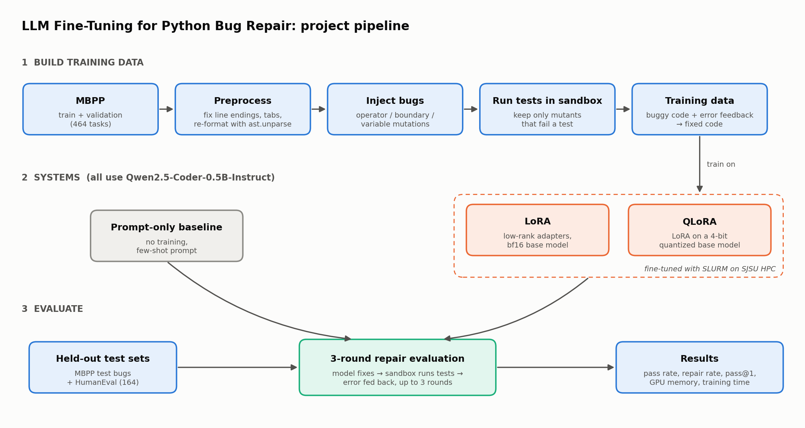

# Project Plan

A plan for completing the project. Milestones follow the CMPE 258 deadlines: check-ins on Oct 19, Nov 2
and Nov 16, the report on Nov 27 and the presentation on Nov 30.

## Tentative abstract

> Code language models often generate programs with logic or syntax errors that fail unit tests. We
> investigate whether parameter-efficient fine-tuning can teach a small code model to repair Python
> programs using execution feedback. Starting from correct MBPP solutions, we inject controlled bugs
> (operator, boundary and variable mutations) and run unit tests in a sandbox to build triples of
> buggy code, test feedback and fixed code. We fine-tune Qwen2.5-Coder-0.5B-Instruct with LoRA and
> QLoRA and compare them with a prompt-only baseline in a three-round repair loop, where the model
> receives the failing test output after each attempt. We evaluate on held-out MBPP tasks and on
> HumanEval, reporting pass rate, per-round repair rate and pass@1 alongside trainable parameters,
> peak GPU memory and training time, to characterize the accuracy versus compute trade-off of each
> approach.

## Overview



## Phases

Leads follow the roles in the proposal.

| # | Phase | Due | Lead | Support | Output |
|---|---|---|---|---|---|
| 0 | Data exploration ✅ | Check-in 1 (Oct 14) | Abhinand, Neha | All | `DATA_EXPLORATION.md`, `exploration/`, `explore_mbpp.py` |
| 1 | Execution sandbox | Check-in 2 (Oct 19) | Neha | Abhinand | `src/sandbox.py` |
| 2 | Bug-mutation pipeline | v1 by Check-in 2, final by Check-in 3 (Nov 2) | Abhinand | Sai Bhavana | `src/mutate.py`, `data/processed/*.jsonl` |
| 3 | Prompt format and baseline | Check-in 3 (Nov 2) | Neha | Abhinand | `src/prompts.py`, baseline results |
| 4 | LoRA / QLoRA training on HPC | HPC setup by Check-in 2, test runs by Check-in 3, full runs by Check-in 4 (Nov 16) | Sai Bhavana | Abhinand | `src/train.py`, `slurm/*.sbatch`, adapters |
| 5 | Multi-round evaluation | Check-in 4 (Nov 16) | Neha | Abhinand | `src/evaluate.py`, `results/*.json` |
| 6 | Analysis and report | Report (Nov 27), slides (Nov 30) | Neha | All | Charts, tables, final report, slides |

### Phase 1: Execution sandbox
Needed by the mutation pipeline, the baseline and the evaluation, so build it first.
- Run a program and its tests in a separate subprocess with a timeout (e.g. 5 s), a memory limit and a
  temporary working directory.
- Return a structured result: `passed`, `error_type`, `error_message`, a short traceback, and which
  test failed.
- Use a common interface for both test formats: MBPP `assert` lists and HumanEval `check(candidate)`.
- Validate it by running all reference solutions. They should all pass; drop any that don't.

### Phase 2: Bug-mutation pipeline
- Preprocess: normalize line endings, expand tabs, and re-serialize with `ast.unparse` (see
  `DATA_EXPLORATION.md` §5).
- Mutate with `ast.NodeTransformer` (operator, boundary and variable).
- Bug difficulty levels:

  | Level | How it is created | Status |
  |---|---|---|
  | 1. Single mutation | One operator, boundary or variable change per mutant | Done |
  | 2. Multiple mutations | 2–3 changes applied to the same solution | Done |
  | 3. Real model mistakes | Base Qwen model solves MBPP train tasks; failing answers are paired with the reference solution | May implement if time allows |

- Skip variable swaps that involve shadowed built-ins (`sum`, `max`, `str`, and so on).
- Run each mutant in the sandbox and keep it only if it **fails** at least one test. Deduplicate.
- Cap mutants per task and per bug type to balance the dataset (boundary sites are scarcer).
- Store each example as JSONL with `task_id`, `problem`, `buggy_code`, `feedback`, `fixed_code`,
  `bug_type`, `level` and `round`.
- Generate train and validation data from the MBPP train and validation splits only. Never mutate
  MBPP test tasks or HumanEval into training data.
- Report yield statistics: mutants generated versus kept for each bug type, and error-type
  distribution.

### Phase 3: Prompt format and baseline
- Define one chat-template prompt used everywhere: problem statement, current code, test feedback,
  then an instruction to return only the corrected function.
- Write a robust code extractor for model output (fenced code blocks, stray text).
- Baseline: the untuned Qwen2.5-Coder-0.5B-Instruct with the same prompt, plus 1–2 few-shot examples
  from MBPP tasks 1–10.
- Check how long the baseline takes per task to estimate the evaluation budget on the cluster.

### Phase 4: LoRA / QLoRA training
- Use `trl.SFTTrainer` with `peft`, computing the loss only on the fixed-code response, not the prompt.
- Starting hyperparameters (tune lightly on validation):

  | | LoRA | QLoRA |
  |---|---|---|
  | Base precision | bf16 | 4-bit NF4 + double quantization (`bitsandbytes`) |
  | Rank / alpha / dropout | 16 / 32 / 0.05 | 16 / 32 / 0.05 |
  | Target modules | q, k, v, o, gate, up, down projections | same |
  | Learning rate | 2e-4, cosine schedule, 3% warmup | same |
  | Epochs | 2–3 | 2–3 |
  | Max sequence length | 1024 (confirm with tokenizer) | same |

- Fix random seeds. If time allows, run 2–3 seeds for error bars.
- Log trainable parameters, peak GPU memory (`torch.cuda.max_memory_allocated`), wall-clock training
  time and the loss curves.
- SLURM: one `.sbatch` per configuration. Check the SJSU HPC documentation for the GPU partition name,
  time limits and module or conda setup. Do a quick smoke-test job on a small subset first.

### Phase 5: Multi-round evaluation
The protocol is the same for all three systems:
1. Round 1: give the model the task, the buggy code and the test feedback.
2. Run the returned code in the sandbox. If it passes, stop. Otherwise feed back the new error.
3. Repeat for up to 3 rounds. Use greedy decoding, so pass@1 is deterministic.

Evaluation sets:
- **Held-out MBPP:** mutants of MBPP test tasks, generated by the same pipeline with a fixed seed.
- **HumanEval:** a decision is needed (see Open decisions).

Metrics:
- **Pass rate:** share of tasks whose final program passes all tests.
- **Repair rate @ round k:** share of initially failing programs fixed by round k (k = 1, 2, 3).
- **HumanEval pass@1.**
- **Efficiency:** trainable parameters, peak GPU memory, training time, inference time per task.
- Optional breakdown by bug type and error type, and by bug level if levels 2–3 are implemented.

### Phase 6: Analysis and report
- Main results table with every metric for the baseline, LoRA and QLoRA.
- Charts: repair rate by round (line chart), accuracy versus GPU memory or training time (scatter),
  and repair rate by bug type (bar chart).
- A few qualitative examples: successful repairs, failures and over-corrections.

## Timeline

| Due | Milestone | Owners |
|---|---|---|
| Check-in 1, Oct 14 | ✅ Data exploration, project plan, repo set up | Abhinand, Neha |
| Check-in 1, Oct 14 | ✅ Prompt lengths measured with the Qwen tokenizer | Sai Bhavana |
| Check-in 2, Oct 19 | Sandbox done and reference solutions validated | Neha (lead), Abhinand |
| Check-in 2, Oct 19 | ✅ Mutation pipeline v1 with first survival counts per bug type | Abhinand (lead), Sai Bhavana |
| Check-in 2, Oct 19 | HPC access and training environment ready | Sai Bhavana (lead), Abhinand |
| Check-in 3, Nov 2 | ✅ Final mutation dataset with survival statistics | Abhinand (lead), Sai Bhavana |
| Check-in 3, Nov 2 | Prompt format and prompt-only baseline results | Neha (lead), Abhinand |
| Check-in 3, Nov 2 | LoRA and QLoRA test runs on the HPC | Sai Bhavana (lead), Abhinand |
| Check-in 4, Nov 16 | Full LoRA and QLoRA training runs (extra seeds if time) | Sai Bhavana (lead), Abhinand |
| Check-in 4, Nov 16 | Three-round evaluation on MBPP test and HumanEval | Neha (lead), Abhinand |
| Report, Nov 27 | Analysis, qualitative examples, charts and final paper | Neha (lead), all members |
| Presentation, Nov 30 | Slides (6 max) and software demo | All members |

## Proposed repository layout

```
├── README.md
├── DATA_EXPLORATION.md
├── PROJECT_PLAN.md
├── requirements.txt
├── exploration/            # dataset statistics and figures
├── src/
│   ├── data.py             # loading and preprocessing MBPP / HumanEval
│   ├── sandbox.py          # safe code execution
│   ├── mutate.py           # bug injection
│   ├── prompts.py          # prompt template and code extraction
│   ├── train.py            # LoRA / QLoRA training
│   └── evaluate.py         # multi-round repair evaluation
├── slurm/                  # .sbatch job scripts for SJSU HPC
├── configs/                # training configs (baseline, lora, qlora)
├── data/                   # raw/ and processed/ (git-ignored)
└── results/                # metrics JSON, charts
```

## Open decisions

1. **How to use HumanEval.** Choose one of:
   - **(a)** The model writes a solution from the prompt, then repairs it over three rounds using test
     feedback. This matches "pass@1".
   - **(b)** Mutate canonical solutions with the same pipeline and repair them. This matches the
     training task more closely.

   Option (a) measures end-to-end usefulness; option (b) is cleaner. We could report both.
2. **Visible versus hidden tests.** If the feedback comes from the same tests used for scoring,
   results are optimistic. For HumanEval, we could use the docstring examples or a subset of asserts as
   visible feedback and score on the full test. MBPP has only three tests, so we'll probably use all
   three and note it as a limitation.
3. **Split.** Decided: keep the official MBPP split. The mutation yield is high enough
   (`DATA_EXPLORATION.md` §10).
4. **Full or sanitized MBPP.** Full gives more data; sanitized gives cleaner problem statements.

## Risks

| Risk | Mitigation |
|---|---|
| Low mutation yield (equivalent mutants, weak 3-test suites) | Measure yield early (by Check-in 2); allow 2 bugs per mutant; rebalance the split |
| HPC queue waits or GPU limits | Smoke-test small jobs early; the 0.5B model also fits on a single consumer GPU or Colab as a fallback |
| Evaluation too slow (3 rounds × hundreds of tasks × 3 systems) | Batch generation; subsample the MBPP test set if needed |
| Synthetic bugs are simpler than real model mistakes | May add level 2–3 bugs; HumanEval option (a) tests repair of the model's own mistakes; mention as a limitation |
| Benchmark contamination (Qwen may have seen MBPP or HumanEval in pretraining) | Affects all three systems equally; mention as a limitation; our mutated buggy inputs are new |
| Sandbox security | Subprocess isolation, timeouts and memory limits; never run model output in the main process |

## Report outline

1. **Abstract**
2. **Introduction:** motivation, research question, contributions
3. **Related work:** code LLMs, self-repair and self-debugging with execution feedback, LoRA and QLoRA
4. **Data:** MBPP and HumanEval, exploration findings, bug-mutation pipeline, dataset statistics
5. **Method:** model, prompt format, the three systems, training setup, three-round repair protocol,
   sandbox
6. **Experimental setup:** hardware (SJSU HPC, SLURM), hyperparameters, metrics
7. **Results:** main table, repair rate by round, accuracy versus compute, breakdown by bug type
8. **Discussion:** qualitative examples, failure analysis, limitations
9. **Conclusion and future work**
10. **References**
11. **Appendix:** prompt templates, additional examples, team contributions
