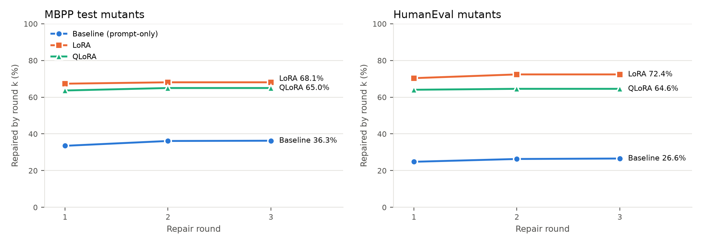
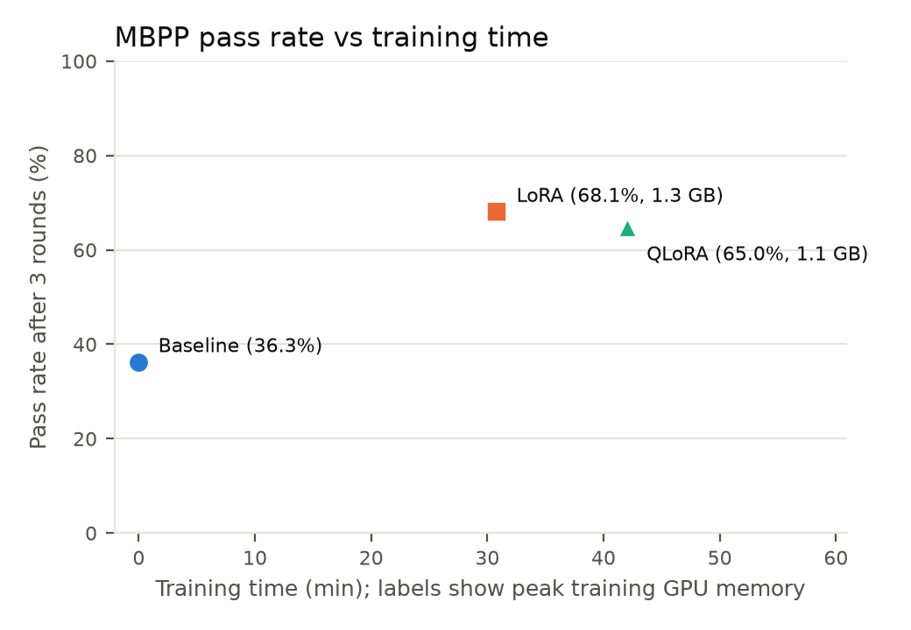
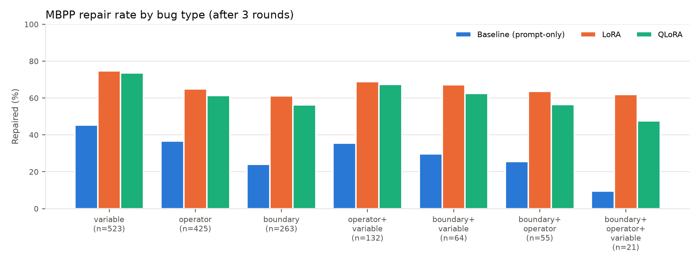
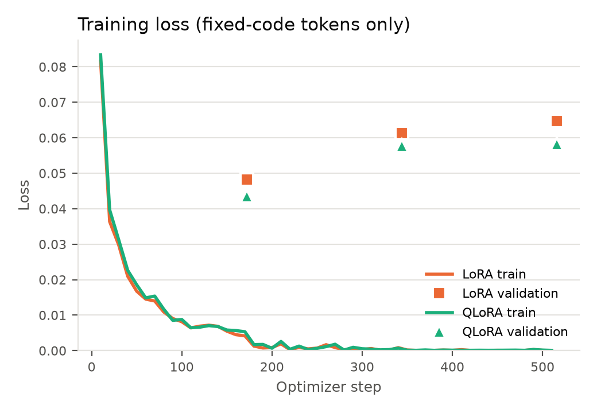

# Results

Generated by `python src/analyze.py` from `results/train_*.json` and `results/eval_*.json`. Greedy decoding, up to 3 repair rounds; a dash means that run is missing.

## Main results

| System | Trainable params | MBPP pass rate | HumanEval mutants pass rate | HumanEval pass@1 | HumanEval after repair | Train time (min) | Train peak GPU (GB) |
|---|---|---|---|---|---|---|---|
| Baseline (prompt-only) | 0 | 36.3% | 26.6% | 51.2% | 55.5% | 0.0 | - |
| LoRA | 8.80M (1.75%) | 68.1% | 72.4% | 7.9% | 7.9% | 30.8 | 1.29 |
| QLoRA | 8.80M (2.716%) | 65.0% | 64.6% | 1.2% | 1.2% | 42.0 | 1.15 |

## Repair rate by round

Share of initially failing programs fixed by round k (cumulative). For the mutant sets every program fails at the start; for HumanEval generate + repair the denominator is the tasks whose first attempt failed.

| System | Eval set | Round 1 | Round 2 | Round 3 | Unchanged answers (round 1) |
|---|---|---|---|---|---|
| Baseline (prompt-only) | MBPP test mutants | 33.5% | 36.1% | 36.3% | 32.4% |
| LoRA | MBPP test mutants | 67.4% | 68.1% | 68.1% | 2.5% |
| QLoRA | MBPP test mutants | 63.6% | 65.0% | 65.0% | 2.8% |
| Baseline (prompt-only) | HumanEval mutants | 24.8% | 26.3% | 26.6% | 48.4% |
| LoRA | HumanEval mutants | 70.4% | 72.4% | 72.4% | 6.3% |
| QLoRA | HumanEval mutants | 64.0% | 64.6% | 64.6% | 5.8% |
| Baseline (prompt-only) | HumanEval generate + repair | 8.8% | 8.8% | 8.8% | 56.2% |
| LoRA | HumanEval generate + repair | 0.0% | 0.0% | 0.0% | 96.7% |
| QLoRA | HumanEval generate + repair | 0.0% | 0.0% | 0.0% | 96.3% |

## MBPP repair rate by bug type

| Bug type | n | Baseline (prompt-only) | LoRA | QLoRA |
|---|---|---|---|---|
| variable | 523 | 45.3% | 74.8% | 73.6% |
| operator | 425 | 36.7% | 64.9% | 61.4% |
| boundary | 263 | 23.9% | 61.2% | 56.3% |
| operator+variable | 132 | 35.6% | 68.9% | 67.4% |
| boundary+variable | 64 | 29.7% | 67.2% | 62.5% |
| boundary+operator | 55 | 25.4% | 63.6% | 56.4% |
| boundary+operator+variable | 21 | 9.5% | 61.9% | 47.6% |

## Efficiency

| System | Final train loss | Train steps | Eval s/task (MBPP) | Eval peak GPU (GB, MBPP) | Few-shot | Device |
|---|---|---|---|---|---|---|
| Baseline (prompt-only) | - | - | 0.21 | 2.17 | 1 | NVIDIA A100-PCIE-40GB |
| LoRA | 0.0058 | full | 0.26 | 2.71 | 0 | NVIDIA A100-PCIE-40GB |
| QLoRA | 0.0061 | full | 0.39 | 2.22 | 0 | NVIDIA A100-PCIE-40GB |

## Figures

